# Avaliação de GitHub Actions

Dupla: Beatrys Belo e Nicoly Ribeiro Barbosa (Nicaribeiro).

##  CI

- Execução verde: https://github.com/Beatrys-lira/oauth-pages-lab/actions/runs/38403056711
- Execução vermelha proposital: https://github.com/Beatrys-lira/oauth-pages-lab/actions/runs/38403429375
- Execução vermelha no PR: https://github.com/Beatrys-lira/oauth-pages-lab/actions/runs/38403435899
- Execução após a correção: https://github.com/Beatrys-lira/oauth-pages-lab/actions/runs/38403817794
- Linha do log: `Parse error near line 1: near "TABL": syntax error`.
- Erro introduzido: `CREATE TABL` no lugar de `CREATE TABLE`.
- A etapa de migração falhou; a validação HTML foi interrompida nessa execução.
- A migração é testada em SQLite local para detectar erros SQL antes de alterar o D1 remoto.

## Proteção da main

PR: https://github.com/Beatrys-lira/oauth-pages-lab/pull/1

A main está protegida com o check verificar obrigatório para todos. O PR #1 ficou bloqueado com o CI vermelho (https://github.com/Beatrys-lira/oauth-pages-lab/actions/runs/38408351137); o estado foi observado no GitHub. As capturas legíveis foram refeitas no PR #12, abaixo. A migração foi corrigida na mesma branch.

- CI aprovado após a correção: https://github.com/Beatrys-lira/oauth-pages-lab/actions/runs/38411843773
- Prova de git push direto recusado: https://github.com/Beatrys-lira/oauth-pages-lab/actions/runs/38411832786
- Saída: `remote: error: GH006: Protected branch update failed for refs/heads/main.` e `HEAD -> main (protected branch hook declined)`.
- O teste de push rodou em job temporário com contents: write. Após registrar a recusa, esse job foi removido e o CI final voltou a usar somente contents: read.
- PR liberado com os quatro checks aprovados e integrado: https://github.com/Beatrys-lira/oauth-pages-lab/pull/1
- CI final do PR: https://github.com/Beatrys-lira/oauth-pages-lab/actions/runs/38412162543
- Revisão final do PR: https://github.com/Beatrys-lira/oauth-pages-lab/actions/runs/38412162179

## Revisão por IA

Workflow implementado em .github/workflows/revisao-ia.yml.

COPILOT_PAT foi cadastrado. O log detalhado mostrou que o modelo gpt-4.1 não estava disponível; a entrada model foi ajustada para usar o padrão do Copilot (https://github.com/Beatrys-lira/oauth-pages-lab/actions/runs/38410480268). A versão v1 indicada no enunciado usa GitHub Models; a revisão foi adaptada para a implementação Copilot do próprio GitHub, fixada em commit.

A revisão publicou um comentário: https://github.com/Beatrys-lira/oauth-pages-lab/pull/1#issuecomment-6147496997

Crítica: a IA afirmou que model vazio poderia impedir a revisão. Isso é incorreto para a implementação fixada: ela permite que o Copilot CLI escolha o modelo padrão. O próprio comentário foi publicado por uma execução com model vazio, demonstrando que a configuração funciona.

- Revisão do SQL vulnerável: https://github.com/Beatrys-lira/oauth-pages-lab/pull/1#issuecomment-6147520110
- Revisão após correção com prepare().bind(): https://github.com/Beatrys-lira/oauth-pages-lab/pull/1#issuecomment-6147547424
- Teste sem pull-requests: write: https://github.com/Beatrys-lira/oauth-pages-lab/actions/runs/38411484218
- Linha do log: `GraphQL: Resource not accessible by integration (addComment)`.
- A permissão foi restaurada após o teste.

## Migrações remotas

Migração inicial: migrations/0001_cria_notas.sql.

Banco configurado: oauth-pages-bd, binding DB. wrangler.toml e migrar.yml publicados na branch de avaliação; os secrets Cloudflare foram cadastrados pela estudante. A migração 0002_adiciona_coluna.sql adiciona observacao à tabela notas. As duas migrações passaram no SQLite local, com a coluna confirmada por PRAGMA.

- Merge com migrações: https://github.com/Beatrys-lira/oauth-pages-lab/commit/47518513aaf43bd567d9f011c9707208f904d95e
- Execução remota aprovada (tentativa 2): https://github.com/Beatrys-lira/oauth-pages-lab/actions/runs/38412457034/attempts/2
- As migrações 0001_cria_notas.sql e 0002_adiciona_coluna.sql foram aplicadas.
- O step "Confirma estrutura da tabela notas" executou PRAGMA table_info(notas) no D1 remoto e retornou:
  `{"cid":3,"name":"observacao","type":"TEXT","notnull":0,"dflt_value":null,"pk":0}`
- A primeira tentativa falhou por caracteres extras em CLOUDFLARE_ACCOUNT_ID; o valor foi corrigido, e a segunda tentativa passou.
- Segundo merge (somente documentação): https://github.com/Beatrys-lira/oauth-pages-lab/pull/3
- Commit desse merge: https://github.com/Beatrys-lira/oauth-pages-lab/commit/f447bf433c4eaf3a7ff6b54ad93efd3b66cb0b09
- A consulta de execuções para esse commit retornou somente execuções de ci (https://github.com/Beatrys-lira/oauth-pages-lab/actions/runs/38413896824 e https://github.com/Beatrys-lira/oauth-pages-lab/actions/runs/38413972888), sem migrar. O filtro paths exige mudanças em migrations/.
- Histórico de migrações para verificar a ausência de nova execução: https://github.com/Beatrys-lira/oauth-pages-lab/actions/workflows/migrar.yml

## Entrega

Este arquivo reúne os links de execução, os comentários da IA, os erros observados e as quatro respostas. As capturas complementares estão incorporadas na seção final deste arquivo; as evidências obrigatórias permanecem nos links das execuções.

## Perguntas

### 1. Por que o CI roda duas vezes?

Um push numa branch com PR aberto dispara o evento push e também synchronize do pull_request. A execução pull_request testa o merge proposto com a base, enquanto push testa o commit da branch. Nesta configuração, o GitHub mostra as duas verificações verificar como obrigatórias, então ambas precisam passar; isso aparece nos prints do PR #12.

### 2. Por que um fork não recebe COPILOT_PAT?

Código de um fork é controlado por outra pessoa e não recebe os secrets do repositório de destino no evento pull_request. Isso impede que um workflow malicioso envie o token a terceiros.

### 3. Por que declarar permissions?

As permissões explícitas limitam o GITHUB_TOKEN ao acesso necessário: leitura do código e escrita de comentários no PR. Assim o workflow não depende de permissões padrão e reduz o impacto de uso indevido do token.

### 4. A revisão da IA substitui o status check?

Não: a revisão da IA pode conter erros ou omissões, enquanto o CI executa as verificações e fornece o check obrigatório. A IA sugeriu que model vazio poderia impedir a revisão, mas a ação aceita usar o modelo padrão e publicou o comentário nessas condições. Esse erro mostra por que a revisão exige avaliação humana.

## Conferência das evidências em 15/10/2026

O PDF exige links das execuções e registros dos resultados; as capturas complementam esses links.

O bloqueio foi repetido no [PR #12](https://github.com/Beatrys-lira/oauth-pages-lab/pull/12), com um arquivo SQL temporário e inválido. O [CI do PR falhou](https://github.com/Beatrys-lira/oauth-pages-lab/actions/runs/38820830248), os dois checks verificar ficaram vermelhos e o botão de merge foi desabilitado. O arquivo de teste foi removido da mesma branch antes da integração.

Após a remoção do teste, o mesmo PR ficou com quatro checks aprovados e o botão de merge habilitado. [CI aprovado do PR #12](https://github.com/Beatrys-lira/oauth-pages-lab/actions/runs/38821055391) e [revisão da correção](https://github.com/Beatrys-lira/oauth-pages-lab/actions/runs/38821055410).

A consulta das execuções do segundo merge foi repetida: [execuções do commit f447bf4](https://api.github.com/repos/Beatrys-lira/oauth-pages-lab/actions/runs?head_sha=f447bf433c4eaf3a7ff6b54ad93efd3b66cb0b09&per_page=100). Retornou duas execuções de ci e nenhuma de migrar; o PR #3 alterou somente AVALIACAO.md.

## Capturas das evidências

Capturas reais das páginas do GitHub, feitas em 15/10/2026. Os logs e comentários originais são de 13/10/2026; o teste de bloqueio e liberação do PR #12 foi repetido em 15/10/2026. As imagens complementam os links exigidos pelo PDF.

| Exigência | Onde conferir |
| --- | --- |
| CI verde, CI vermelho e erro SQL | Imagens 01 e 02 |
| PR bloqueado e depois liberado na mesma branch | Imagens 03 e 04, PR #12 |
| Push direto recusado | Imagem 05 |
| IA aponta SQL vulnerável e confere a correção | Imagens 06 e 07, PR #1 |
| Falha sem permissão de comentar | Imagem 08 |
| Migração remota e nova coluna confirmada | Imagens 09 e 10 |
| Merge sem migrations não dispara migrar | Imagem 11 e consulta das execuções acima |
| Afirmação da IA analisada criticamente | Imagem 12 e parágrafo da seção Revisão por IA |

### 01. CI aprovado

As verificações de segredos, migrações e HTML passaram.

[Registro original](https://github.com/Beatrys-lira/oauth-pages-lab/actions/runs/38403056711/job/115315375536)

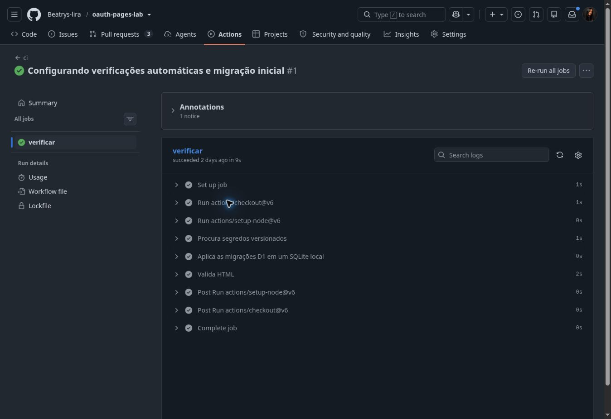

### 02. CI vermelho com erro proposital

O log mostra CREATE TABL e a falha na aplicação da migração.

[Registro original](https://github.com/Beatrys-lira/oauth-pages-lab/actions/runs/38403429375/job/115316681179)

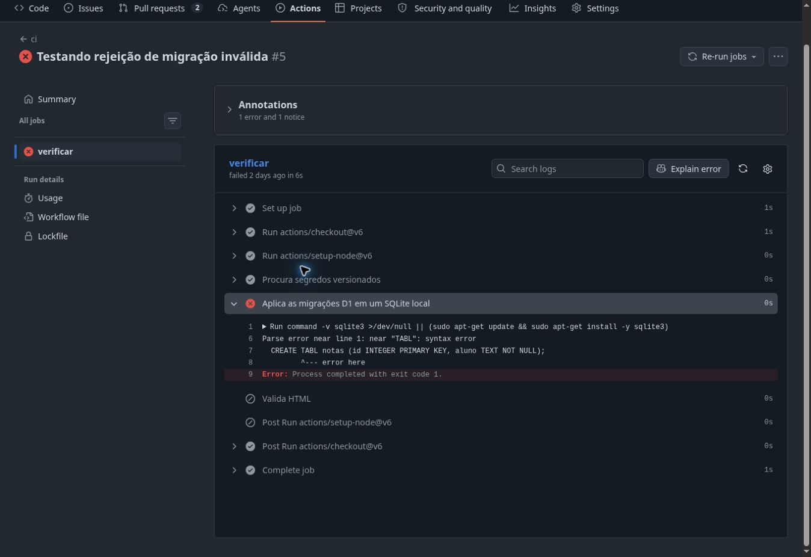

### 03. PR bloqueado

No PR #12, os checks verificar de push e pull_request estão vermelhos e obrigatórios. O botão Merge pull request está desabilitado.

[Registro original](https://github.com/Beatrys-lira/oauth-pages-lab/pull/12)

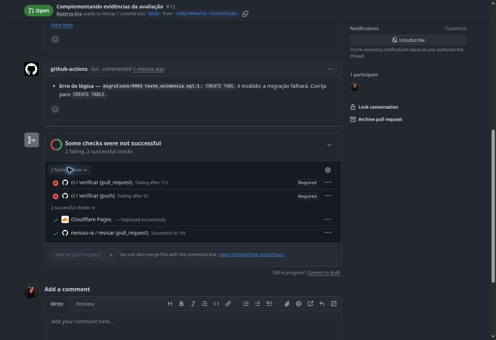

### 04. Mesmo PR liberado após correção

O arquivo SQL temporário foi removido da mesma branch. Os quatro checks passaram e o botão de merge ficou habilitado, antes da inclusão destas capturas.

[Registro original](https://github.com/Beatrys-lira/oauth-pages-lab/pull/12)

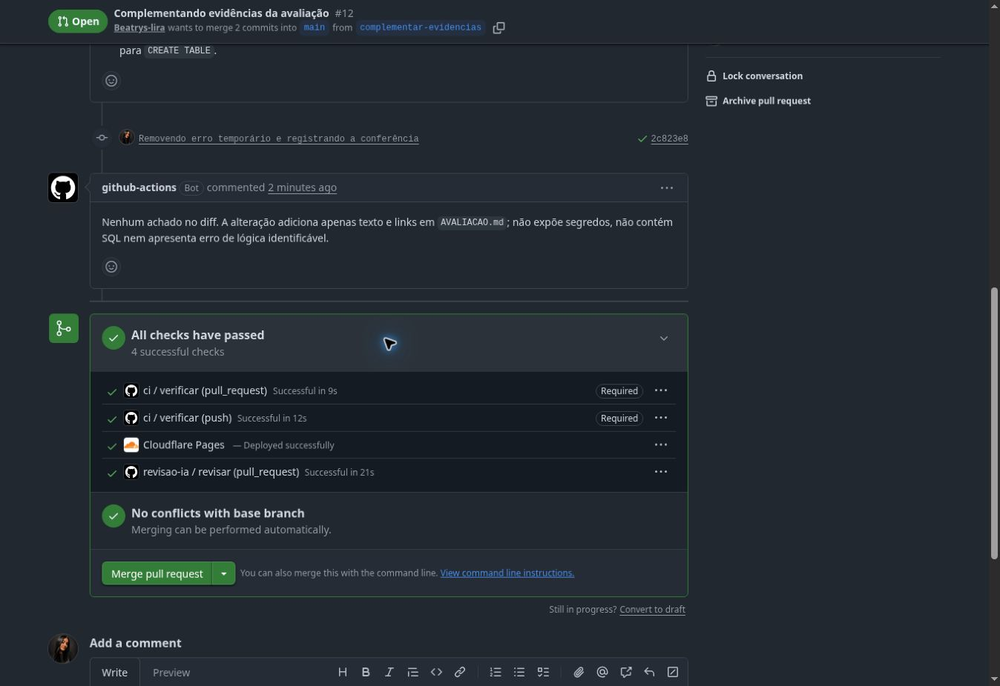

### 05. Push direto recusado

O log registra GH006, Required status check verificar e protected branch hook declined.

[Registro original](https://github.com/Beatrys-lira/oauth-pages-lab/actions/runs/38411832786/job/115345867845#step:3:21)

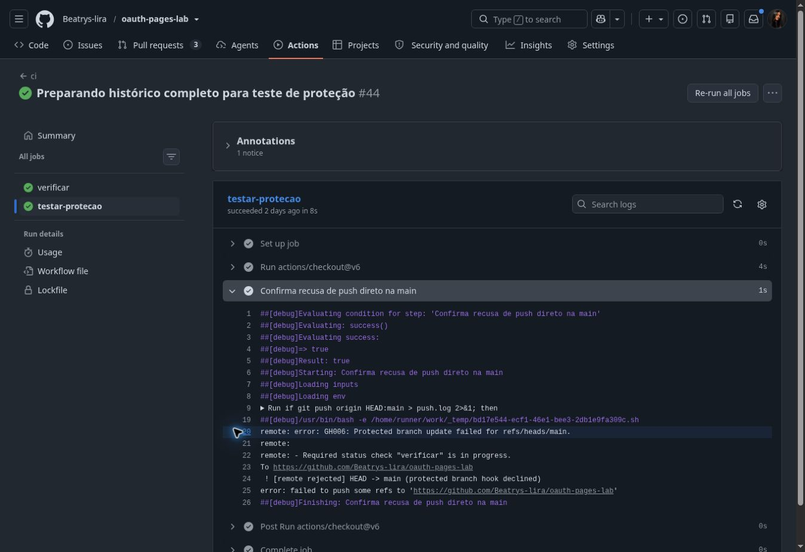

### 06. IA aponta SQL vulnerável

A revisão identifica a interpolação de nome na consulta e recomenda prepare().bind().

[Registro original](https://github.com/Beatrys-lira/oauth-pages-lab/pull/1#issuecomment-6147520110)

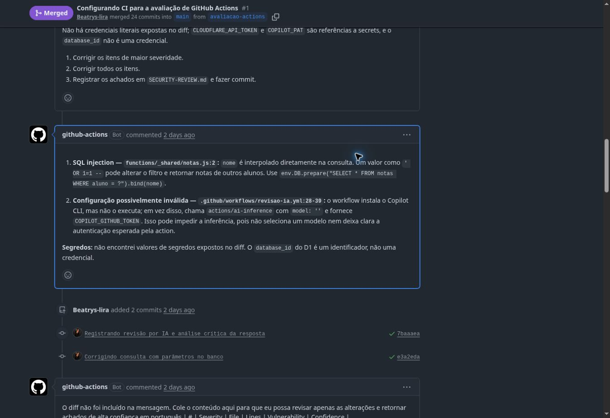

### 07. IA confere a consulta corrigida

O novo comentário confirma que a consulta usa prepare().bind() corretamente.

[Registro original](https://github.com/Beatrys-lira/oauth-pages-lab/pull/1#issuecomment-6147547424)

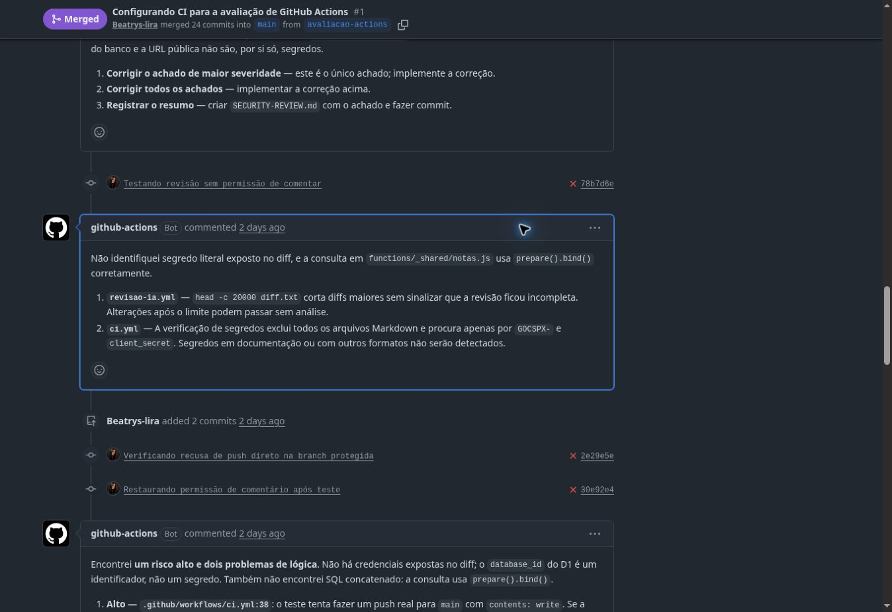

### 08. Erro sem permissão de comentar

A etapa Comenta no PR falha com GraphQL: Resource not accessible by integration (addComment). A permissão foi restaurada depois do teste.

[Registro original](https://github.com/Beatrys-lira/oauth-pages-lab/actions/runs/38411484218/job/115344673690)

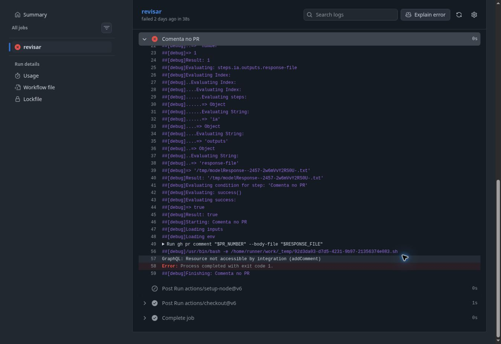

### 09. Migrações aplicadas no D1 remoto

As migrações 0001_cria_notas.sql e 0002_adiciona_coluna.sql aparecem concluídas.

[Registro original](https://github.com/Beatrys-lira/oauth-pages-lab/actions/runs/38412457034/job/115350250224#step:4:65)

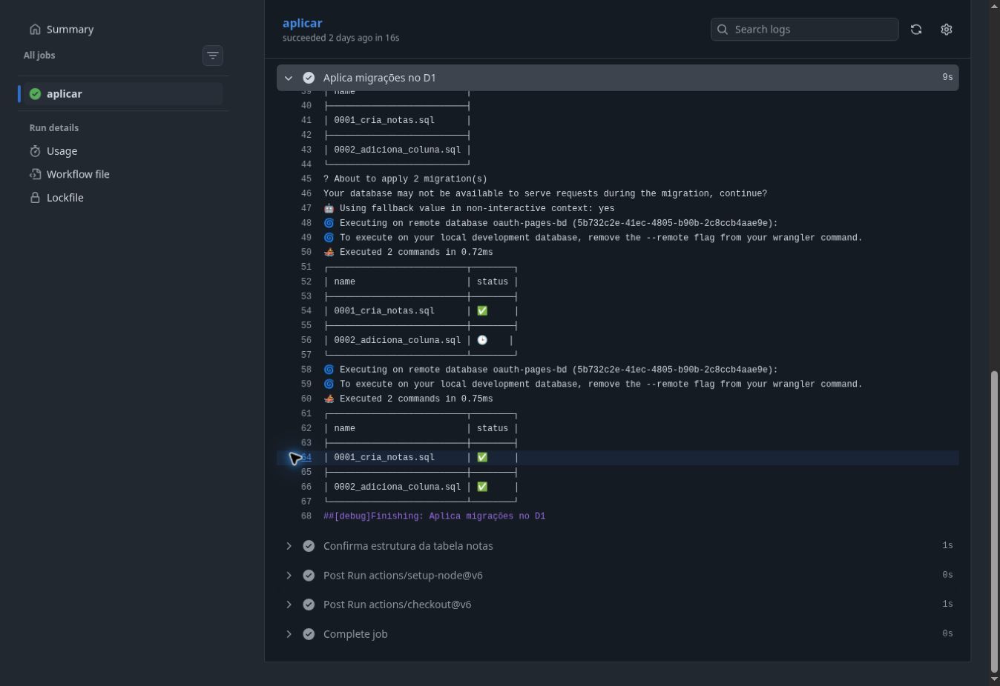

### 10. PRAGMA confirma a nova coluna

A saída da consulta remota mostra cid 3, name observacao e type TEXT.

[Registro original](https://github.com/Beatrys-lira/oauth-pages-lab/actions/runs/38412457034/job/115350250224#step:5:70)

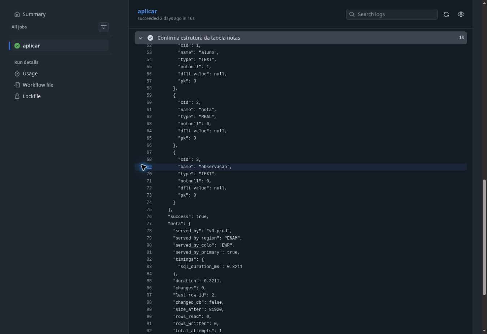

### 11. Merge sem migração

O commit f447bf4 altera somente AVALIACAO.md e mostra Cloudflare Pages e CI nos checks, sem migrar. A consulta de execuções acima confirma a ausência de migrar para esse commit.

[Registro original](https://github.com/Beatrys-lira/oauth-pages-lab/commit/f447bf433c4eaf3a7ff6b54ad93efd3b66cb0b09)

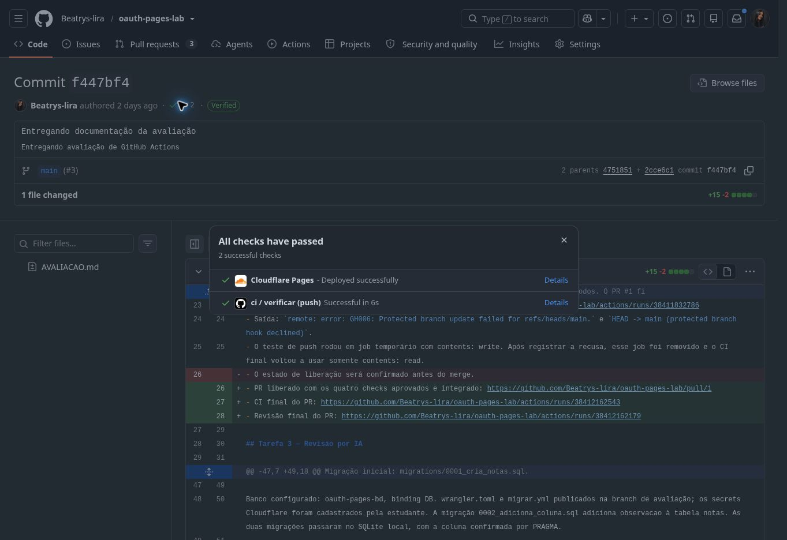

### 12. Afirmação da IA analisada criticamente

O segundo item do comentário questiona model vazio. A explicação de por que essa afirmação não se aplica à implementação utilizada está na seção Revisão por IA.

[Registro original](https://github.com/Beatrys-lira/oauth-pages-lab/pull/1#issuecomment-6147496997)

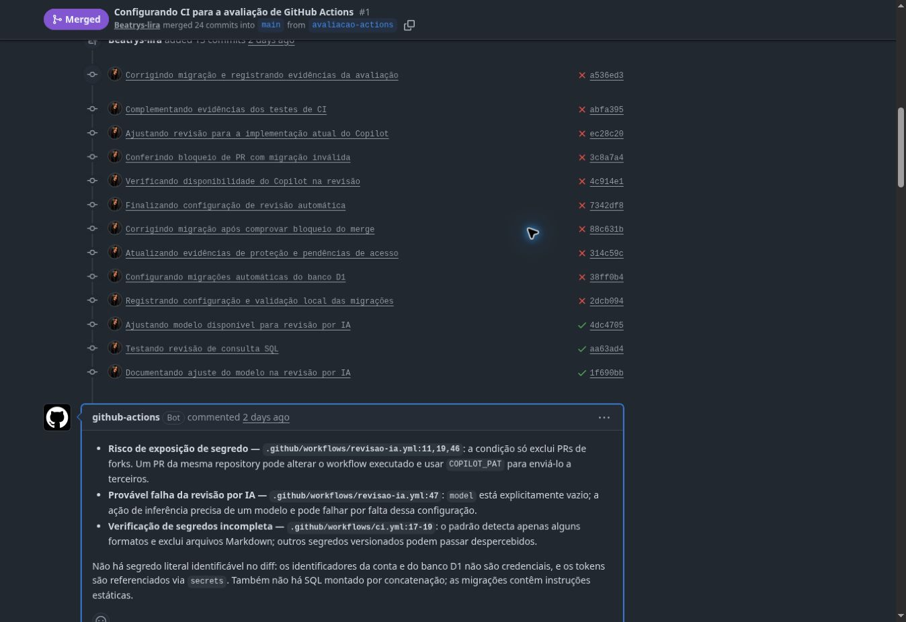

